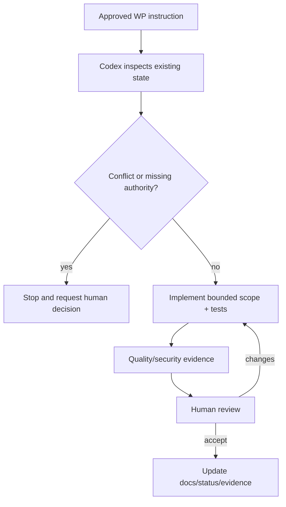

# Phase 1 Execution Checklist

## Before each package

- [ ] Status is Ready or Ready with conditions whose conditions are Passed.
- [ ] Dependencies are Accepted and human development approval is recorded.
- [ ] Architecture/ADR and verified policy references were reviewed.
- [ ] Database plan/migration approval, permission, office scope, authority and audit are unambiguous.
- [ ] Automated/manual tests and observable acceptance criteria are defined.
- [ ] Out-of-scope and prohibited changes are understood.
- [ ] Git branch/baseline are correct; unrelated user changes are isolated.
- [ ] Baseline tests pass or approved known failures are documented.

## After implementation

- [ ] Acceptance criteria and Phase 1 DoD pass.
- [ ] Relevant PHP/frontend quality commands pass.
- [ ] Security/scope/audit and negative tests pass.
- [ ] Documentation/traceability/changelog are updated.
- [ ] Files/commits/commands/results/screenshots/approvals/limitations are recorded.
- [ ] Human review completed and status updated.

