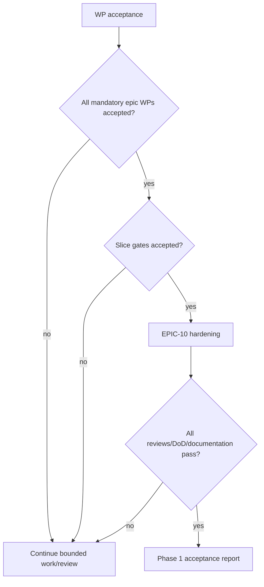

# Phase 1 Backlog Summary

The inventory contains 10 epics and 116 work packages: 7 baseline, 7 conventions, 13 organization, 11 office scope, 11 authorization, 11 audit, 14 references, 14 policy registry, 16 shell and 12 hardening.

Status policy at publication:

- WP-01-01 is Ready with conditions and is the only package eligible for first authorization.
- WP-01-02–05/07 are Blocked by predecessor evidence; WP-01-06 is Deferred unless baseline defects are approved for remediation.
- EPIC-02–10 packages are Blocked or Ready with conditions on exact architecture/security/data dependencies. None is pre-authorized.
- There are no unconditionally Ready packages because Phase 0.13 administrative entry gates remain Pending.

Database work is isolated into reviewable schema packages and never constitutes migration approval. Backend, UI, permissions, audit, test and documentation packages remain dependency-bound. Appointment/workforce and later business modules are absent by design.

Final planning recommendation: **PHASE 1 BACKLOG READY WITH CONDITIONS**. Coding does not begin automatically.
